# HipMRI 2D Improved U-Net - s4983404

Research prototype for prostate/pelvic organ segmentation. Easy baseline: basic 2D U-Net;
Normal main model: a documented 2D adaptation of the approved Improved U-Net reference.
Both 20-epoch models have frozen-test results. Anatomical exploration identifies ID5 as the prostate for this coursework; the evidence and its limits are documented below.

## Working principles and reference mapping

Both networks encode images at five resolutions and concatenate encoder features into
the decoder. The baseline uses double 3x3 ReLU convolutions, max pooling and learned
transposed upsampling. Padded convolutions and width 16 are explicit practical
adaptations of [U-Net](https://arxiv.org/abs/1505.04597), not an exact 2015 reproduction.

The Normal architecture follows section 2.1 and figure 1 of
[Isensee et al. (2018)](https://arxiv.org/abs/1802.10508): residual context modules
(two pre-activation 3x3 convolutions with dropout 0.3), strided downsampling,
InstanceNorm, leaky ReLU slope 0.01, nearest upsampling followed by convolution,
3x3/1x1 localization with channel reduction, and three summed segmentation heads.
We replace 3D operators with 2D, four input modalities with one MRI channel, and
overlapping tumour outputs with six exclusive pelvic class logits. We use CE plus
foreground soft Dice, rather than claiming to reproduce the paper's entire training
recipe. Neither 2D network observes adjacent slices. Original code was written from
the architectural description; no student implementation was copied.

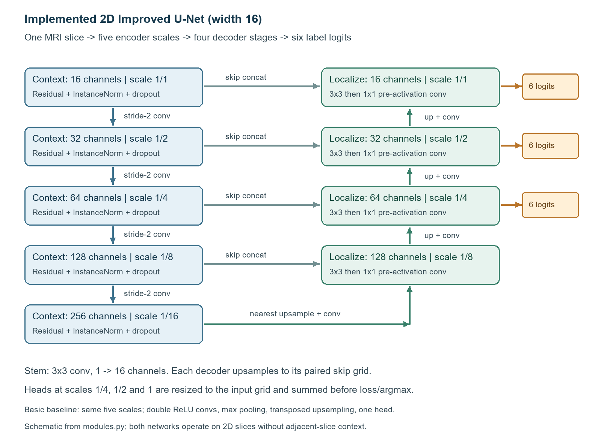

The schematic follows `modules.py`: channel widths 16/32/64/128/256, four paired decoder stages, and three six-channel heads summed at the original image resolution. It illustrates the implemented 2D adaptation rather than the original paper's 3D network.

## Data and leakage prevention

Read-only root: `/home/groups/comp3710/HipMRI_Study_open/keras_slices_data`.
Preserve supplied train/validate/test folders: 11,460/660/540 slices, 31/4/3
filename-defined patients, no patient overlap. Repeated weeks stay in the same split.
No random slice split. `audit_data.py` rejects missing pairs, nonfinite pixels,
shape/affine mismatch and values outside integer IDs 0..5; it writes per-split manifests.
Normalization is per-image z-score, independent of all other images, with a constant
image guard. Preserve native shape without geometric resampling. Full audit found
11,400 training slices at 256x128 and 60 at 256x144; validation/test are 256x128.
Batch collation pads the bottom/right to the batch maximum; zero-sum target channels
mark padding, which is excluded from loss and confusion counts. Inference stays native.
Six one-hot channels remain present even on slices missing an organ. Optional training
augmentation flips the first array axis jointly; disabled for the first controlled runs.

### Class distribution and patient separation

| Split | Patients | Image/mask pairs | ID5-positive slices | Real pixels |
|---|---:|---:|---:|---:|
| train | 31 | 11,460 | 4,152 | 375,767,040 |
| validate | 4 | 660 | 254 | 21,626,880 |
| test | 3 | 540 | 195 | 17,694,720 |

| Label ID | Train pixels (%) | Validation pixels (%) | Test pixels (%) |
|---|---:|---:|---:|
| 0 | 17.271 | 13.759 | 16.168 |
| 1 | 67.511 | 70.332 | 68.289 |
| 2 | 12.495 | 13.105 | 12.252 |
| 3 | 1.942 | 1.748 | 2.372 |
| 4 | 0.357 | 0.561 | 0.580 |
| 5 | 0.426 | 0.496 | 0.339 |

Percentages use all native, unpadded mask pixels within each split, not the fraction of slices or patients. ID5 occupies less than 0.5% of pixels in every split, so overall pixel accuracy would be misleading. The test ID5 share is smaller than training; the fixed patient split is retained rather than adjusted to make these distributions match. CE plus foreground soft Dice is the shared training objective; no resampling or test-driven class weighting was introduced.

Validation subjects are 036-039 and test subjects 040-042. The 31 training IDs listed in the audit are disjoint from both sets; repeated weeks stay within their patient split. These checks establish filename-defined patient separation, not an exhaustive pixel-hash duplicate search. The original [full audit summary](evidence/data_audit_20261020.json) retains counts and subject lists; its historical label-status field describes the audit date.

### Anatomical identification of ID5

For this coursework, **ID5 is identified as the prostate by anatomical exploration of the supplied masks and MRI images**. This is a documented interpretation of the data, rather than a label dictionary supplied by the teaching team. Numeric ID5 is retained beside the anatomical name so the result can be checked independently.

The interpretation uses two checks. First, three preselected training subjects (004, 015 and 025, week 0) show a small central pelvic ID5 region. For each subject the displayed slice has the largest ID5 area in that week, selected from ground truth without consulting predictions. In subjects 004 and 025 it lies immediately below the fluid-bright, ID3-labelled bladder region; subject 015 shows the central target in a slice without ID3. These panels support location and appearance, not prediction performance or a population-wide anatomical validation.

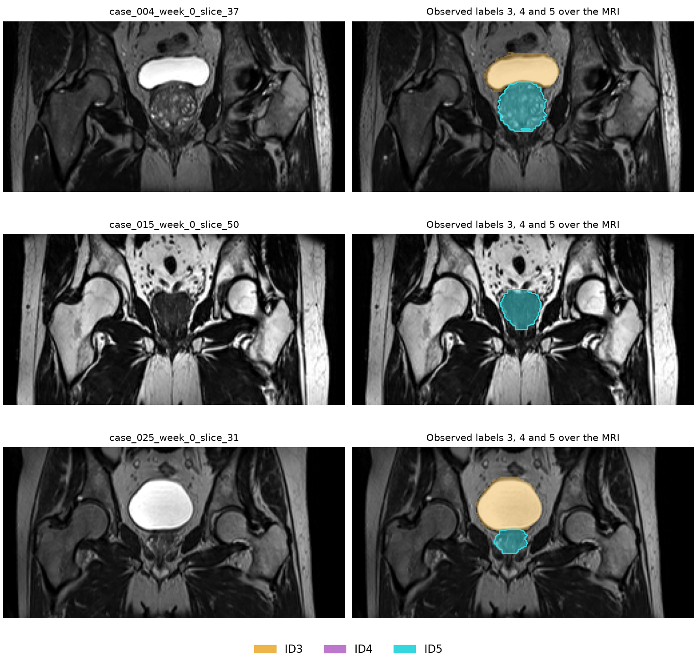

Second, the separate 3D sample B006_Week0 was inspected in sagittal, coronal and axial views after canonical reorientation using its image affine. The ID3 region follows the bladder; ID4 follows the posterior rectal region. ID5 is inferior to ID3 and anterior to ID4 in the same coordinate frame, and forms a compact central region. These observed spatial relationships match the prostate's position below the bladder and in front of the rectum described by the [National Cancer Institute anatomy resource](https://training.seer.cancer.gov/prostate/anatomy/). The external resource explains anatomy; it does not certify HipMRI label numbers.

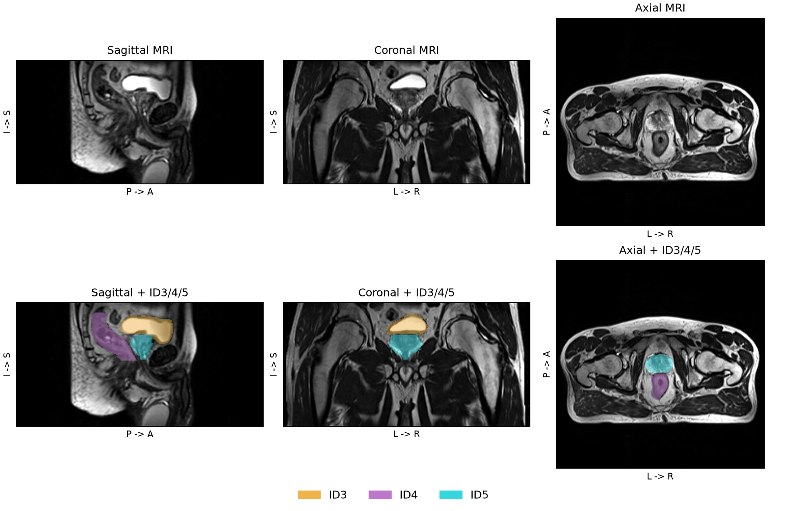

This figure is a dataset-inspection aid, not a 3D model result. No 3D network was trained or evaluated: both submitted models take one 2D slice at a time and use `Conv2d`. The selected main model remains the Normal-difficulty 2D Improved U-Net.

The [exploration record](evidence/label_exploration_20261028.json) lists the exact files, selection rule, class counts, orientations and centroids. It was added on 28 October after the frozen experiments; the training recipe, validation-based checkpoint choice and test predictions were unchanged. The resulting coursework interpretation is **prostate (ID5): baseline test Dice 0.8453 and Improved test Dice 0.8614**, both above the 0.75 coursework target under this identification. This is not a clinician-validated annotation dictionary.

The separate 3D example is supporting anatomical context, not proof of an exact patient or slice mapping to the supplied 2D folders. The 2D identity-like affines and 1-unit spacings do not preserve trustworthy original physical geometry. Accordingly, boundary distances remain in pixels, and 2D mask-transition endpoints are not renamed anatomical base/apex. The numerical results remain meaningful independently of the anatomical interpretation.


## Environment and use

Verified Rangpur versions: Python 3.11.13 (recorded in both completed runs),
PyTorch 2.14.0+cu130, NumPy 2.4.6, nibabel 5.4.2, matplotlib 3.11.1,
SciPy 1.17.1 (boundary analysis and its tests).
Use the existing `~/venv`. No nilearn or pytest needed. Local PyTorch cannot import
`c10.dll`; user approved equivalent CPU tests on Rangpur before GPU submission.

```bash
# Start inside recognition/HipMRI_ImprovedUNet_s4983404 on Rangpur.
source "$HOME/venv/bin/activate"
export OMP_NUM_THREADS=2
python -m unittest discover -s tests -v
python audit_data.py --output audit_new
# Small CPU inference check, using the original retained checkpoint:
python predict.py --device cpu --split validate --count 3 \
  --checkpoint "$HOME/hipmri_report_20261020_v4/runs/improved_full_679896/best.pt" \
  --output runs/improved_cpu_preview
```

The retained checkpoint path is in the student's account; another user must obtain
an authorized copy or retrain. Weights are not downloaded by cloning the repository.
Commands that write outputs require a new output directory. Do not overwrite previous results.
Arguments, checkpoint architecture, patient splits and model construction are all checked
before that directory is created, so a rejected start leaves no half-built run behind.
`--evaluate` reads `--model` and `--width` from the checkpoint; a different value is refused.
Use Slurm for GPU training, not the login node. No `--mem` request on this cluster;
`comp3710` jobs require `--account=comp3710`. `submit_smoke.sh` is 15 minutes on
`a100-test`. The measured 20-epoch runs use `sbatch submit_train.sh basic` or
`sbatch submit_train.sh improved` (20-minute budget and unique job-ID output folders).
Run JSON records config/versions/hardware; training saves validation-selected weights,
history, curves, log and resource measurements. Predict preserves native output affine.
Datasets and weights remain excluded from Git. Trained weight locations and
reproduction instructions are listed at the end of this report.
See [Reproduction guide](REPRODUCIBILITY.md) for a clean checkout, CPU checks,
training and evaluation commands, expected outputs, and verification evidence.
For new MRI slices without ground truth, `predict.py --input <file-or-directory>`
loads 2D NIfTI images directly and generates input/prediction panels. Optional
`--labels <directory>` adds ground-truth comparisons; see the guide for naming.

## Evaluation conventions

Exclusive argmax predictions, no tuned threshold. Aggregate integer confusion counts
over pixels for per-class Dice=2TP/(2TP+FP+FN), IoU=TP/(TP+FP+FN).
Both-empty class is undefined (`null`), not a perfect score; one-empty gives zero.
Also report patient-level pooled counts; test has only three patients.
Checkpoints use validation ID5 pooled Dice. ID5 is interpreted as prostate on the anatomical evidence above; this later reporting clarification does not change the checkpoint-selection rule. No test feedback enters model selection.
GPU latency: batch one, five warmups, 30 synchronized forwards, excluding I/O;
peak allocated and reserved memory includes training. This is slice latency, not
full-volume latency. Validation failure analysis includes pixel HD95; millimetre distances require trustworthy geometry.

## Frozen 20-epoch experiment results

Numeric IDs are retained for traceability; ID5 is interpreted as prostate using the exploration above.
Checkpoints were selected using validation only; test argmax was evaluated once per model.

| Model / job | Epochs / selected epoch | Best val ID5 Dice | Test ID5 Dice | Test ID5 IoU |
|---|---:|---:|---:|---:|
| basic / 679897 | 20 / 19 | 0.8258 | 0.8453 | 0.7321 |
| improved / 679896 | 20 / 9 | 0.8466 | 0.8614 | 0.7566 |

| ID | Basic Dice | Improved Dice | Basic IoU | Improved IoU |
|---|---:|---:|---:|---:|
| 0 | 0.9965 | 0.9968 | 0.9931 | 0.9936 |
| 1 | 0.9838 | 0.9850 | 0.9682 | 0.9704 |
| 2 | 0.9344 | 0.9376 | 0.8768 | 0.8826 |
| 3 | 0.9652 | 0.9646 | 0.9328 | 0.9317 |
| 4 | 0.8314 | 0.8635 | 0.7115 | 0.7599 |
| 5 | 0.8453 | 0.8614 | 0.7321 | 0.7566 |

| Patient | Basic ID5 Dice | Improved ID5 Dice |
|---|---:|---:|
| 040 | 0.8521 | 0.8662 |
| 041 | 0.8295 | 0.8259 |
| 042 | 0.8341 | 0.8664 |

| Model | Parameters | Peak allocated / reserved MiB | Train loop s | Batch-one latency ms |
|---|---:|---:|---:|---:|
| basic | 1,940,902 | 661.6 / 974.0 | 706.0 | 2.06 |
| improved | 3,189,714 | 2026.6 / 3026.0 | 916.7 | 5.84 |

Training-loop time excludes cache loading. Slurm wall time is recorded in the retained logs.
Latency excludes I/O; five warmups, 30 synchronized batch-one forwards on A100-PCIE-40GB.
Both models use the frozen shared recipe in [evaluation plan](EVALUATION_PLAN.md).

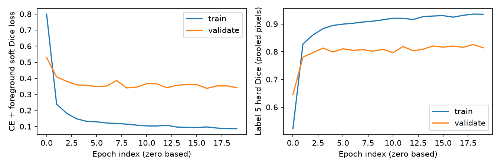

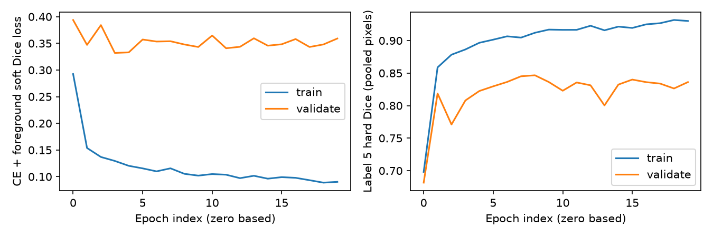

## Validation boundary failures

Basic: five worst positive-label slices. Improved: two worst misses plus three explicit error modes.
Selection is deliberately biased toward failures; these panels are not test averages.
ID5 is the anatomically identified prostate target in this report. HD95 uses symmetric pooled 4-connected surface distances in pixels.
Both-empty and one-empty distances are undefined, with reasons retained in JSON.

**basic:** median finite slice HD95 4.00 px (237 finite; 389 both-empty; 34 one-empty). Finite-only median omits total misses.

| Slice | Dice | FP / FN pixels | HD95 px | Predicted components |
|---|---:|---:|---:|---:|
| case_036_week_0_slice_17.nii.gz | 0.0000 | 0 / 17 | undefined | 0 |
| case_037_week_0_slice_10.nii.gz | 0.0000 | 0 / 56 | undefined | 0 |
| case_037_week_0_slice_11.nii.gz | 0.0000 | 0 / 84 | undefined | 0 |
| case_037_week_0_slice_50.nii.gz | 0.0000 | 0 / 155 | undefined | 0 |
| case_037_week_0_slice_51.nii.gz | 0.0000 | 0 / 35 | undefined | 0 |

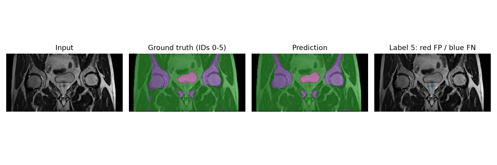

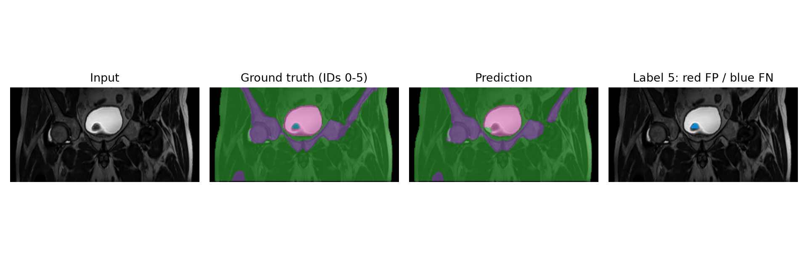

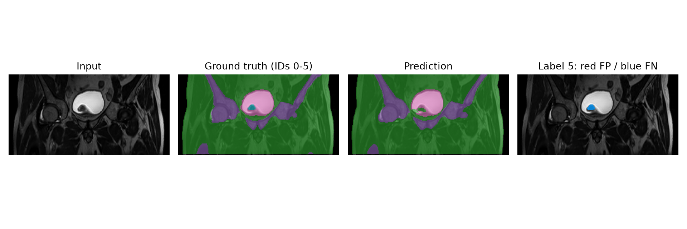

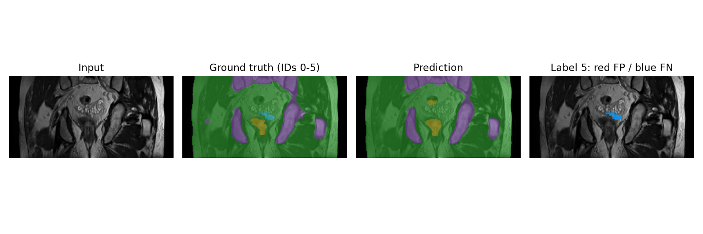

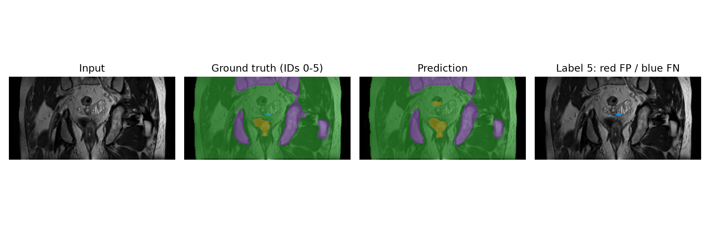

**improved:** median finite slice HD95 3.61 px (240 finite; 393 both-empty; 27 one-empty). Finite-only median omits total misses.

| Slice | Dice | FP / FN pixels | HD95 px | Predicted components |
|---|---:|---:|---:|---:|
| case_036_week_0_slice_45.nii.gz | 0.0000 | 0 / 64 | undefined | 0 |
| case_037_week_0_slice_49.nii.gz | 0.0000 | 0 / 315 | undefined | 0 |
| case_038_week_0_slice_35.nii.gz | 0.6823 | 231 / 0 | 5.00 | 1 |
| case_038_week_0_slice_27.nii.gz | 0.6057 | 16 / 53 | 4.00 | 2 |
| case_038_week_0_slice_42.nii.gz | 0.0000 | 15 / 56 | 23.59 | 1 |

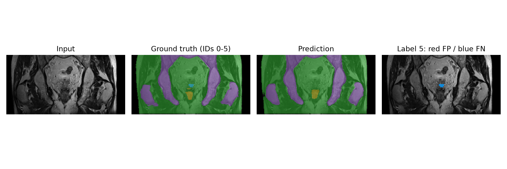

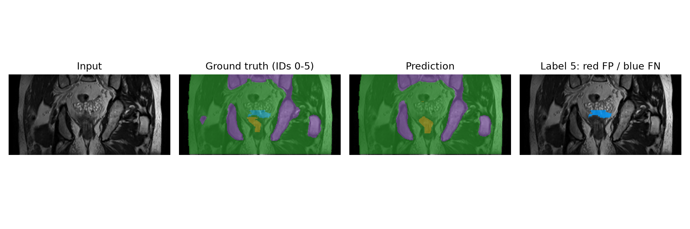

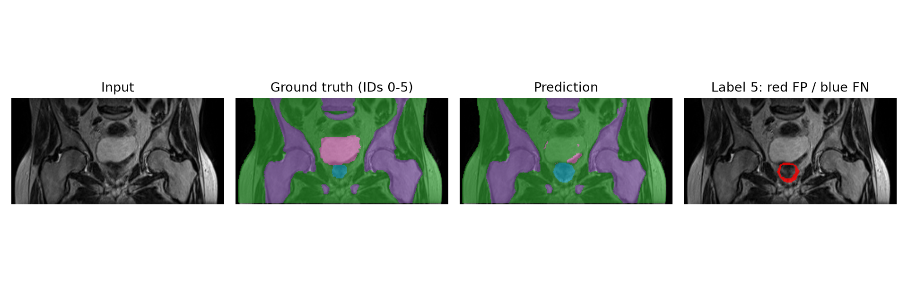

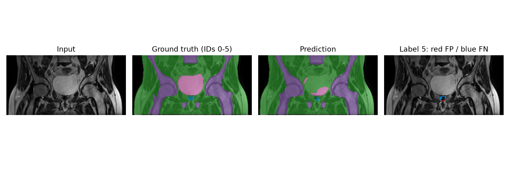

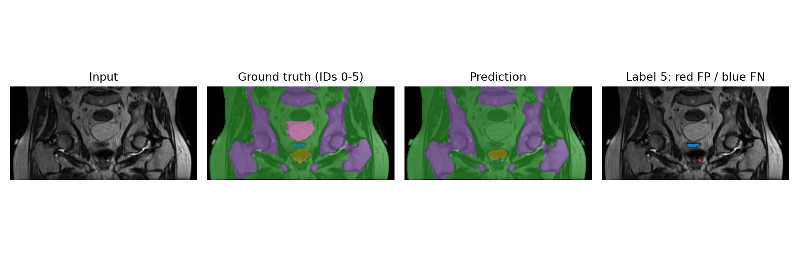


## Failure autopsy and engineering recommendation

The five Improved examples above were visually inspected. Counts are observations;
appearance-based explanations below are hypotheses, not confirmed anatomical causes.
The last three panels were rendered on CPU from the same saved checkpoint. Aggregate
test tables retain the original frozen GPU pass. Corrected validation analysis matches
checkpoint Dice within 0.00002; batch-one versus batch-16 floating-point kernels can
change a few boundary pixels. The earlier failed image export was excluded.

| Actual validation case | Paired baseline / Improved ID5 Dice | Observed error and likely trigger | Practical response |
|---|---:|---|---|
| 036, week 0, slice 45 | 0.4976 / 0.0000 | Improved omits all 64 target pixels while baseline retains 52. A small local region is suppressed among surrounding tissue; added complexity does not consistently preserve small targets. | Review empty predictions near mask transitions; do not infer safety from overall Dice. |
| 037, week 0, slice 49 | 0.1120 / 0.0000 | All 315 target pixels are missed by Improved. In slices 49-52 the target shrinks from 315 to 155, 35 and 5 pixels, and all are omitted. This is a transition failure, not merely a single one-pixel error. | Inspect neighbouring slices together. Call this a mask-defined transition until the original plane and anatomical direction are established. |
| 038, week 0, slice 35 | 0.7778 / 0.6823 | Improved includes all 248 target pixels but adds 231 FP pixels, versus 137 FP for baseline. The red ring shows boundary expansion around a poorly separated region. | Require local contour review; improved global Dice does not guarantee better local specificity. |
| 038, week 0, slice 27 | 0.0000 / 0.6057 | Improved recovers 53 target pixels, misses 53 and adds 16 FP pixels; its prediction has two 4-connected components. The image shows a split small region. | Treat disconnected target proposals as review candidates. Any component filtering must be validated rather than assumed harmless. |
| 038, week 0, slice 42 | 0.0000 / 0.0000 | Improved misses all 56 target pixels and predicts a separate 15-pixel island. HD95 is 23.59 pixels. Baseline misses the target without this extra island. | A plausible-looking isolated contour can be misplaced; a single-component rule alone would not detect this failure. |

Across all 660 validation slices, complete positive-target misses fall from 17 to 14
and false-positive-only slices from 17 to 13. Median finite HD95 falls from 4.00 to
3.61 pixels, but finite-only summaries exclude one-empty failures and use slightly
different slice populations. These are descriptive validation findings, not proof of
clinical boundary benefit or millimetre accuracy.

On the frozen test split, Improved increases pooled ID5 Dice by 0.0161 and IoU by
0.0245. It improves two of three patients, while patient 041 decreases from 0.8295 to
0.8259. Peak allocated VRAM is about 3.06 times baseline, forward latency 2.84 times,
and training-loop time 1.30 times. Only three test patients and one training seed
support these observations; slice-wise significance claims would be unjustified.

**Recommendation:** retain Improved as the coursework Normal model and the basic
U-Net as the implemented comparison/fallback. Both fit comfortably in the measured
resource budget. The data exploration supports using prostate (ID5) as the coursework target. For any practical use, independent expert review of labels and original geometry is still needed; anatomical base/apex findings cannot be established from these 2D headers. The modest pooled gain and persisting regressions do
not justify claiming that 2D architectural changes solve boundary safety. Defer Hard
3D work until these source questions and additional time/data requirements are clear.

## Midpoint feasibility review

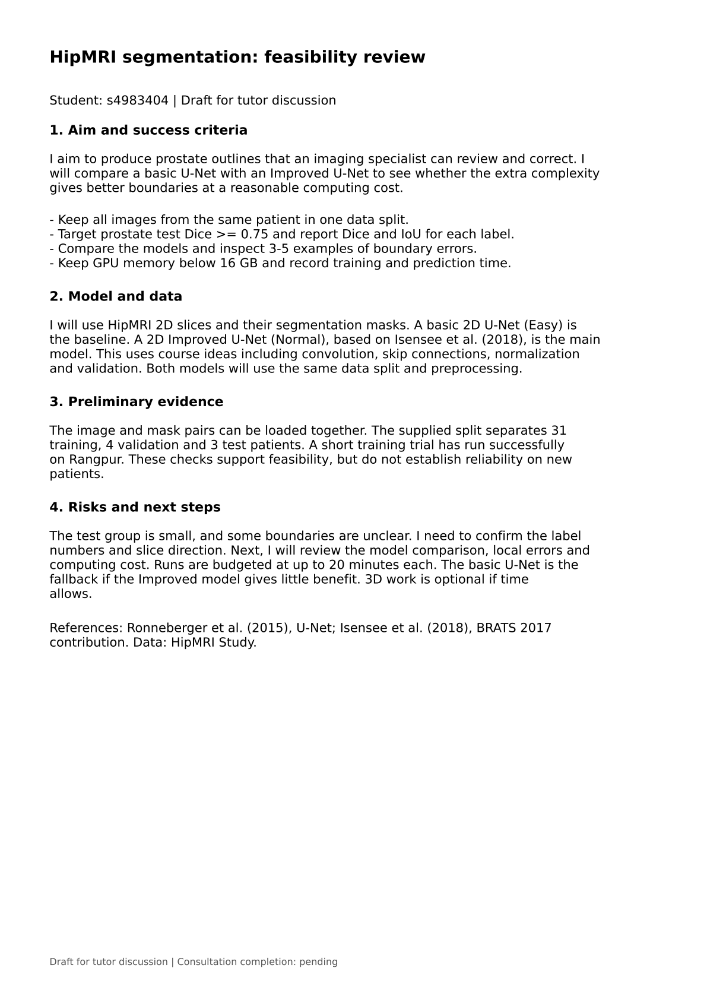

[Open the original PDF](HipMRI_Feasibility_Checkoff.pdf)

## Artificial Intelligence Usage Disclosure

OpenAI Codex assisted with requirement extraction, architecture research, data-audit
scripts, original model/training code, tests, feasibility drafting, anatomical-evidence figures and report/PDF preparation. Verification
uses strict CPU tests, exhaustive pair/pixel auditing, real-data overfit, scheduled
GPU trials and checkpoint reload. Anatomical identification was checked using three training subjects, a separate 3D example and an external anatomy reference; it remains a coursework interpretation. The student must review, understand and defend every implementation and reported claim.

## Data acknowledgment

Data were provided by HipMRI Study via the COMP3710 course dataset. Follow its
noncommercial data-use agreement and do not identify or contact participants.
The agreement recommends https://doi.org/10.1016/j.ijrobp.2015.08.045 for MRI-alone
treatment planning; its segmentation citation field is blank. No invented segmentation
reference is supplied. The supplied files do not include an authoritative anatomical label dictionary; the ID5 interpretation and original-geometry limitations are documented above.

## Experiment evidence

Small original logs are included alongside the report: [Basic training, job 679897](evidence/full_679897.out), [Improved training, job 679896](evidence/full_679896.out), and [frozen evaluation, job 679935](evidence/evaluate_679935.out). They are unchanged copies of the retained outputs; the evaluation log also contains the original validation-image export, which was subsequently corrected as described above. Frozen test metrics were unaffected. The [frozen numeric summary](results/frozen_results.json) preserves the reported measurements, and [SHA-256 checksums](evidence/SHA256SUMS.txt) identify the copied audit, exploration and log evidence. These are supporting records rather than additional training experiments.

The original [evaluation plan](EVALUATION_PLAN.md) is preserved as a pre-test record: its candidate-label wording reflects the information available then. The later anatomical exploration clarifies the report interpretation without changing that historical plan or the frozen numbers.

## Retained weights and reproducibility

Weights remain outside Git on Rangpur:

- `~/hipmri_report_20261020_v4/runs/basic_full_679897/best.pt`
- `~/hipmri_report_20261020_v4/runs/improved_full_679896/best.pt`

Use `predict.py --checkpoint <path> --output <new-directory>` in the existing venv. A public weight link has not been published. Course users with dataset access can retrain using the documented commands. All plots and numeric summary files in this folder are derived from the identified runs; raw datasets and model files are excluded.

Audit guarantees are limited to filename-defined subject separation and numeric grid/label checks; they do not establish original provenance, absence of hidden duplicates or clinical annotation correctness. The submission branch is `topic-recognition` in the student's personal fork, targeting upstream `shakes76/PatternAnalysis-2026:topic-recognition`.
